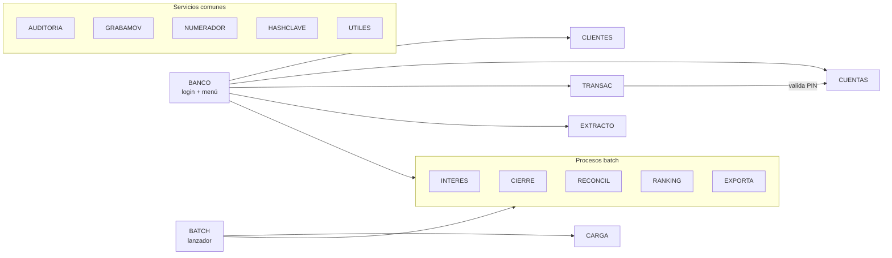

# Sistema de cuentas bancarias en COBOL

Aplicación de consola en **COBOL (GnuCOBOL 3.2)** que administra clientes y cuentas bancarias, procesa depósitos, retiros y transferencias, genera extractos y deja un registro de auditoría de cada operación.

Combina los dos estilos de procesamiento de un banco real:

- **Interactivo**: menú para cajeros y supervisores (`bin/banco`).
- **Batch**: intereses, cierre mensual, reconciliación, ranking y exportación (`bin/batch`), lanzados como pasos de JCL.

## Funcionalidades

| Área | Detalle |
| --- | --- |
| Clientes | Alta con documento único (7 a 12 dígitos) y control de mayoría de edad; modificación de dirección y teléfono; baja lógica (solo sin saldo; cierra sus cuentas); búsqueda por ID, documento (clave alternativa) o apellido (recorrido secuencial). |
| Cuentas | Caja de ahorro o cuenta corriente, PIN de 4 dígitos guardado con hash y "sal", consulta de saldo. |
| Operaciones | Depósito, retiro con **límite diario** (500 por cuenta, se reinicia al cambiar el día) y **transferencia atómica** con compensación. |
| Seguridad | Login de usuarios con roles **cajero** y **supervisor**; **bloqueo tras 3 PIN incorrectos** con desbloqueo manual del supervisor. |
| Reportes | Extracto por período, cierre mensual, ranking de clientes con `SORT`, archivo plano de ancho fijo. |
| Control | Reconciliación de saldos contra movimientos y log de auditoría de solo agregado. |

## Arquitectura



```
banco-cobol/
├── src/
│   ├── BANCO.cbl       Programa principal: login, roles y menú
│   ├── CLIENTES.cbl    Alta, baja, modificación, consulta y búsqueda
│   ├── CUENTAS.cbl     Apertura, saldo, validación de PIN, desbloqueo
│   ├── TRANSAC.cbl     Depósito, retiro y transferencia
│   ├── EXTRACTO.cbl    Extracto de movimientos por período
│   ├── BATCH.cbl       Lanzador de procesos por lotes
│   ├── INTERES.cbl     Batch: intereses mensuales (idempotente)
│   ├── CIERRE.cbl      Batch: resumen del mes
│   ├── RECONCIL.cbl    Batch: saldo vs. suma de movimientos
│   ├── RANKING.cbl     Batch: clientes por saldo (verbo SORT)
│   ├── EXPORTA.cbl     Batch: archivo plano de ancho fijo
│   ├── CARGA.cbl       Datos de prueba
│   ├── AUDITORIA.cbl   Escritura del log
│   ├── GRABAMOV.cbl    Alta de movimientos
│   ├── NUMERADOR.cbl   Secuencias de clientes, cuentas y movimientos
│   ├── HASHCLAVE.cbl   Hash de PIN y claves
│   └── UTILES.cbl      Lectura y validación de números e importes
├── copy/               Copybooks: registros, SELECT y parámetros
├── tests/              TSTALTER.cbl (herramienta de prueba)
├── docs/               Diseño de archivos y reglas de negocio
├── data/               Archivos generados en ejecución
└── reports/            Extractos, cierres y exportaciones
```

Cada registro y cada `SELECT` se define una sola vez en un copybook (`copy/`) y lo comparten todos los programas.

## Compilar y ejecutar

Requiere [GnuCOBOL](https://gnucobol.sourceforge.io/) 3.x con soporte de archivos indexados (BDB o VBISAM).

**Windows (PowerShell)**

```powershell
.\build.ps1 -GnuCobol C:\GnuCOBOL     # o con cobc ya en el PATH: .\build.ps1
.\bin\batch.exe CARGA CONFIRMAR        # datos de prueba
.\bin\banco.exe
```

**Linux / macOS / WSL**

```bash
./build.sh
./bin/batch CARGA CONFIRMAR
./bin/banco
```

Usuarios de prueba: `CAJERO01` / `1234` (cajero) y `SUPER01` / `9999` (supervisor). Las cuentas de prueba y sus PIN están en [docs/DATOS_PRUEBA.md](docs/DATOS_PRUEBA.md).

### Procesos batch

```
batch INTERES  [AAAAMM] [tasa anual]   intereses (tasa por defecto 6.00)
batch CIERRE   [AAAAMM]                reports/CIERRE_AAAAMM.txt
batch RECONCIL                         reports/DISCREPANCIAS.txt (rc 1 si hay diferencias)
batch RANKING                          reports/RANKING_CLIENTES.txt
batch EXPORTA  [AAAAMM]                reports/EXPORT_AAAAMM.txt
batch CARGA    CONFIRMAR               borra y carga datos de prueba
```

Si no se indica el período, se usa el mes actual. El código de retorno del proceso queda como código de salida, igual que el `COND CODE` de un paso de JCL.

## Pruebas

```powershell
.\run_tests.ps1        # Windows
./run_tests.sh         # Linux / macOS / WSL
```

Los scripts compilan, recargan los datos de prueba antes de cada caso y verifican la salida:

| Caso | Escenario | Resultado esperado |
| --- | --- | --- |
| T01 | Retiro mayor al saldo | "Saldo insuficiente" |
| T02 | Cuarto retiro que supera el límite diario | 3 retiros aceptados, el cuarto rechazado |
| T03 | 3 PIN incorrectos | Cuenta bloqueada, el PIN correcto ya no alcanza |
| T04 | Transferencia a cuenta inexistente | Sin cambios en el origen |
| T05 | Cierre ejecutado dos veces | Informe idéntico, sin movimientos nuevos |
| T06 | Saldo alterado a mano | La reconciliación lo detecta (rc 1) |
| T07 | Transferencia correcta | Saldos actualizados y conciliados |
| T08 | Intereses ejecutados dos veces | Se pagan una sola vez |
| T09 | Alta con documento repetido | Rechazo |
| T10 | 3 claves de login incorrectas | Acceso denegado |
| T11 | Cajero entra al menú de supervisor | Rechazo por rol |
| T12 | Alta, apertura con depósito y extracto | Extracto con el saldo final correcto |
| T13 | Supervisor desbloquea una cuenta | La cuenta vuelve a operar |
| T14 | Baja de cliente con y sin saldo | Rechazada / aceptada |
| T15 | Exportación de ancho fijo | Cabecera, 6 detalles y cola de control |

## Decisiones de diseño

**Importes en `COMP-3`.** Todo el dinero se guarda en decimal empaquetado (`PIC S9(11)V99 COMP-3`): aritmética decimal exacta, sin los errores de redondeo del punto flotante. Los intereses usan `ROUNDED`.

**Transferencia atómica con compensación.** Los archivos indexados no tienen transacciones, así que la transferencia:

1. valida todo **antes** de tocar saldos: PIN, que el destino exista y esté abierto, y el saldo del origen;
2. debita el origen (`REWRITE`);
3. acredita el destino (`REWRITE`);
4. si el paso 3 falla, **reacredita el origen** (compensación) y lo registra en auditoría como `COMPENS`;
5. graba los movimientos `TD` y `TC` con el **mismo número de operación**.

Así una transferencia fallida nunca deja dinero "en el aire". Si hasta la compensación fallara, queda registrada para revisión y la reconciliación lo detecta.

**Batch idempotente y reanudable.** Cada cuenta guarda el último período en que cobró intereses (`CTA-ULT-INTERES`). Si el proceso se corta a la mitad, al relanzarlo saltea las cuentas ya pagadas y sigue con el resto; correrlo dos veces en el mes no paga doble. El cierre solo lee, por eso repetirlo da el mismo informe.

**Saldo = suma de movimientos.** Las cuentas se abren en cero y el depósito inicial es un movimiento más, de modo que la reconciliación compara cada saldo con la suma de sus movimientos (tabla en memoria con `OCCURS ... DEPENDING ON` y `SEARCH`). También informa movimientos de cuentas inexistentes.

**Validaciones de retiro en orden.** Cuenta abierta → PIN → reinicio del acumulado diario si cambió la fecha → límite diario → saldo. Recién después se actualiza, así nunca queda un estado a medias.

**PIN y claves con hash.** Se guarda `hash(PIN + nro de cuenta)` y `hash(clave + usuario)`; la "sal" evita que dos PIN iguales den el mismo valor. El algoritmo (djb2 módulo un primo) es didáctico: en producción se usaría un HSM o una función como PBKDF2.

**Auditoría de solo agregado.** `AUDITORIA.LOG` se abre siempre con `OPEN EXTEND`; ningún programa reescribe ni borra líneas.

```
20261028 143015 CAJERO01 RETIRO   CTA:1000000005 IMP:000000200.00 OK
20261028 143120 CAJERO01 RETIRO   CTA:1000000005 IMP:000000050.00 RECHAZADO Limite diario superado
```

**`FILE STATUS` en cada archivo.** Todos los `SELECT` declaran su `FILE STATUS` y se revisa después de cada `OPEN`, `WRITE` y `REWRITE` (00 éxito, 05 archivo opcional creado, 22 clave duplicada, 23 no encontrada, 35 inexistente).

**Limitaciones conocidas.** El sistema es monousuario: no bloquea registros (`READ ... WITH LOCK`) porque cada operación abre y cierra los archivos dentro de una sola sesión. Para uso concurrente habría que agregar `LOCK MODE` y reintentos.

## Documentación

- [docs/DISENO.md](docs/DISENO.md): archivos, registros y formato de exportación.
- [docs/REGLAS.md](docs/REGLAS.md): reglas de negocio y validaciones.
- [docs/DATOS_PRUEBA.md](docs/DATOS_PRUEBA.md): clientes, cuentas y usuarios de prueba.

## Licencia

MIT. Ver [LICENSE](LICENSE).
