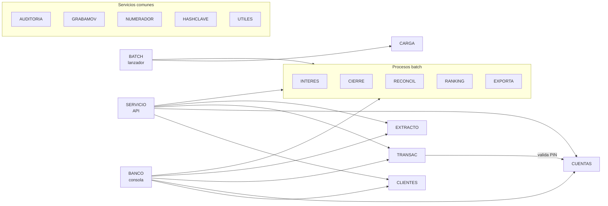

# COBOL Bank Fullstack

Sistema bancario con el **núcleo en COBOL (GnuCOBOL 3.2)**, una **API REST en Python (FastAPI)** y una **app en Flutter para Android y web**.

**App web:** https://facuperma.github.io/cobol-bank-fullstack/ — es la interfaz; para ingresar, la API tiene que estar corriendo en la misma PC (`.\api\run_api.ps1`, ver [Inicio rápido](#inicio-rápido)). Usuarios de prueba: `CAJERO01` / `1234` (cajero) y `SUPER01` / `9999` (supervisor).

El núcleo administra clientes y cuentas, procesa depósitos, retiros y transferencias, liquida intereses, genera extractos e informes y deja un registro de auditoría de cada operación. La API y la app no reimplementan nada de eso: lo usan.

Es la arquitectura de muchos bancos reales. El *core* en COBOL no se reescribe; se le agregan capas modernas encima. Las reglas de negocio viven en un solo lugar y las usan por igual la consola, los procesos batch y la app del celular.

```
┌────────────────────┐   HTTP/JSON   ┌──────────────────┐  stdin/stdout  ┌────────────────────┐
│ App Flutter        │ ────────────> │ API REST         │ ─────────────> │ bin/servicio       │
│ APK Android / web  │ <──────────── │ Python · FastAPI │ <───────────── │ núcleo COBOL       │
└────────────────────┘               └──────────────────┘                └─────────┬──────────┘
                                                                                  │
┌────────────────────┐                                                  ┌─────────▼──────────┐
│ bin/banco (consola)│ ───────────────── mismos programas ────────────> │ archivos indexados │
│ bin/batch (JCL)    │                                                  │ data/*.DAT         │
└────────────────────┘                                                  └────────────────────┘
```

## Contenido

- [Funcionalidades](#funcionalidades)
- [Inicio rápido](#inicio-rápido)
- [Instalación desde cero (Windows)](#instalación-desde-cero-windows)
- [Uso](#uso)
  - [App gráfica](#app-gráfica)
  - [Consola](#consola)
  - [Procesos batch](#procesos-batch)
  - [Usar la app desde el celular](#usar-la-app-desde-el-celular)
- [Datos de prueba](#datos-de-prueba)
- [Arquitectura](#arquitectura)
  - [Estructura del repositorio](#estructura-del-repositorio)
  - [Núcleo COBOL](#núcleo-cobol)
  - [Modo servicio](#modo-servicio)
  - [API REST](#api-rest)
  - [App Flutter](#app-flutter)
- [Reglas de negocio](#reglas-de-negocio)
- [Pruebas](#pruebas)
- [Decisiones de diseño](#decisiones-de-diseño)
- [Solución de problemas](#solución-de-problemas)
- [Limitaciones](#limitaciones)
- [Documentación adicional](#documentación-adicional)

## Funcionalidades

| Área | Detalle |
| --- | --- |
| Clientes | Alta con documento único (7 a 12 dígitos) y control de mayoría de edad; modificación de dirección y teléfono; baja lógica (solo sin saldo; cierra sus cuentas); búsqueda por número, documento (clave alternativa) o apellido. |
| Cuentas | Apertura de caja de ahorro o cuenta corriente con depósito inicial opcional; PIN de 4 dígitos guardado con hash y "sal"; consulta de saldo. |
| Operaciones | Depósito, retiro con **límite diario** (500 por cuenta, se reinicia al cambiar el día) y **transferencia atómica** con compensación. |
| Seguridad | Usuarios con roles **cajero** y **supervisor**; **bloqueo tras 3 PIN incorrectos** con desbloqueo manual del supervisor; sesiones con token en la API. |
| Reportes | Extracto por período, cierre mensual, ranking de clientes con `SORT`, archivo plano de ancho fijo. |
| Control | Reconciliación de saldos contra movimientos y log de auditoría de solo agregado. |
| Interfaces | Consola, procesos batch al estilo JCL, API REST y app gráfica (Android y web). |

## Inicio rápido

Con [GnuCOBOL](#1-gnucobol) y [Python](#2-python) instalados:

```powershell
.\build.ps1 -GnuCobol C:\GnuCOBOL      # compila el núcleo COBOL
.\bin\batch.exe CARGA CONFIRMAR         # carga los datos de prueba
.\api\run_api.ps1                       # levanta la API y la app web
```

Abrir:

- **http://localhost:8000/app/**: la app (requiere haber compilado la versión web; ver [App Flutter](#app-flutter)).
- **http://localhost:8000/docs**: documentación interactiva de la API, para probar cada endpoint desde el navegador.

Usuarios: `CAJERO01` / `1234` (cajero) y `SUPER01` / `9999` (supervisor).

## Instalación desde cero (Windows)

Solo el paso 1 es obligatorio para la consola. La API necesita además el paso 2, y la app los pasos 3 y 4.

### 1. GnuCOBOL

Hace falta GnuCOBOL 3.x **con soporte de archivos indexados** (BDB o VBISAM).

1. Descargar el build de Windows de [Arnold Trembley](https://www.arnoldtrembley.com/GnuCOBOL.htm), por ejemplo `GC32-BDB-SP1` (GnuCOBOL 3.2 con Berkeley DB).
2. El archivo es un autoextraíble de 7-Zip; extraerlo en `C:\GnuCOBOL` (también se puede abrir con `tar -xf archivo.exe -C C:\GnuCOBOL`).
3. Compilar el proyecto:

   ```powershell
   .\build.ps1 -GnuCobol C:\GnuCOBOL
   ```

   Si `cobc` ya está en el `PATH`, alcanza con `.\build.ps1`. También se puede definir la variable `GNUCOBOL_HOME`.

Genera en `bin\`: `banco.exe` (consola), `batch.exe` (procesos), `servicio.exe` (para la API) y `tstalter.exe` (herramienta de prueba).

> Si PowerShell rechaza el script con *"la ejecución de scripts está deshabilitada"*, ejecutar una vez:
> `Set-ExecutionPolicy -Scope CurrentUser RemoteSigned`

En **Linux / macOS / WSL**: instalar el paquete `gnucobol` (por ejemplo `sudo apt install gnucobol`) y usar `./build.sh`.

### 2. Python

Python 3.12 desde [python.org](https://www.python.org/downloads/) (o `winget install Python.Python.3.12`). El acceso directo de la Microsoft Store no sirve.

`.\api\run_api.ps1` crea el entorno virtual `api\.venv` e instala las dependencias de [api/requirements.txt](api/requirements.txt) la primera vez.

### 3. Flutter

```powershell
git clone --depth 1 -b stable https://github.com/flutter/flutter.git C:\flutter
$env:PATH = "C:\flutter\bin;$env:PATH"     # o agregarlo al PATH del sistema
flutter doctor
```

Con esto ya se puede compilar la **versión web**.

### 4. Android SDK (solo para el APK)

Alcanza con Java 17 y las herramientas de línea de comandos; no hace falta Android Studio.

```powershell
winget install Microsoft.OpenJDK.17
```

1. Descargar las *command line tools* para Windows de [developer.android.com/studio](https://developer.android.com/studio#command-line-tools-only).
2. Extraerlas en `%LOCALAPPDATA%\Android\Sdk\cmdline-tools\latest\`.
3. Aceptar las licencias e instalar los paquetes. Desde **bash**: en PowerShell la tubería agrega un BOM y el primer "y" no se reconoce.

   ```bash
   SDK="$LOCALAPPDATA/Android/Sdk"
   yes | "$SDK/cmdline-tools/latest/bin/sdkmanager.bat" --sdk_root="$SDK" --licenses
   "$SDK/cmdline-tools/latest/bin/sdkmanager.bat" --sdk_root="$SDK" "platform-tools" "platforms;android-36" "build-tools;36.0.0"
   ```

4. Indicarle a Flutter dónde están:

   ```powershell
   flutter config --android-sdk "$env:LOCALAPPDATA\Android\Sdk" --jdk-dir "C:\Program Files\Microsoft\jdk-17.0.21.21-hotspot"
   flutter doctor      # "Android toolchain" debe quedar en verde
   ```

## Uso

### App gráfica

La app está pensada para **empleados del banco**. Al ingresar, el rol del usuario define qué secciones ve:

| Sección | Qué permite | Rol |
| --- | --- | --- |
| **Clientes** | Buscar por apellido, documento o número. La ficha muestra datos y cuentas con saldo, estado y accesos a depósito y extracto. Alta de cliente, edición de dirección y teléfono, baja. **Abrir cuenta**: tipo, PIN (dos veces) y depósito inicial; al terminar muestra el número de la cuenta nueva. | Cajero y supervisor |
| **Operaciones** | Depósito, retiro (con PIN) y transferencia (PIN de la cuenta de origen). Pide confirmación y muestra el saldo resultante y el número de operación. | Cajero y supervisor |
| **Consultas** | Saldo con PIN. Extracto por período con saldo inicial, créditos, débitos, saldo final y cada movimiento. | Cajero y supervisor |
| **Supervisor** | Desbloqueo de cuentas. Procesos batch (intereses, cierre, reconciliación, ranking, exportación) con su salida y el informe generado. | Solo supervisor |

En la PC la navegación va en una barra lateral y en el celular en una barra inferior. Los importes se ingresan como `1500`, `1500.50` o `1.500,50` y se muestran como `$ 1.500,50`. Respeta el modo oscuro del sistema.

### Consola

```powershell
.\bin\banco.exe
```

```
==========================================
   SISTEMA BANCARIO - MENU PRINCIPAL
==========================================
  1. Gestion de clientes
  2. Apertura de cuenta
  3. Deposito
  4. Retiro
  5. Transferencia
  6. Consulta de saldo
  7. Extracto
  8. Procesos batch (supervisor)
  9. Salir
```

Pide usuario y clave (3 intentos). Cada opción pide sus datos y responde con `OK: ...` o `ERROR: ...`. El extracto además queda en `reports/EXTRACTO_<cuenta>.txt`.

### Procesos batch

```
batch INTERES  [AAAAMM] [tasa anual]   intereses (tasa por defecto 6.00)
batch CIERRE   [AAAAMM]                reports/CIERRE_AAAAMM.txt
batch RECONCIL                         reports/DISCREPANCIAS.txt (rc 1 si hay diferencias)
batch RANKING                          reports/RANKING_CLIENTES.txt
batch EXPORTA  [AAAAMM]                reports/EXPORT_AAAAMM.txt
batch CARGA    CONFIRMAR               borra y carga datos de prueba
```

Si no se indica el período, se usa el mes actual. El código de retorno del proceso queda como código de salida, igual que el `COND CODE` de un paso de JCL. Desde la línea de comandos corren con el usuario `BATCH`; desde la app o la consola, con el supervisor que los lanza.

### Usar la app desde el celular

1. **Compilar el APK** con la IP de la PC en la red local (se ve con `ipconfig`):

   ```powershell
   cd app
   flutter build apk --dart-define=API_URL=http://192.168.1.41:8000
   ```

   Queda en `app\build\app\outputs\flutter-apk\app-release.apk`.

2. **Levantar la API** en la PC con `.\api\run_api.ps1`. Escucha en todas las interfaces; con `-SoloLocal` se limita a la PC.
3. **Firewall**: la primera vez Windows pregunta si permite Python; aceptar para **redes privadas**.
4. **Instalar el APK**: copiarlo al teléfono y abrirlo. Android pide permiso para instalar apps de origen desconocido.
5. El teléfono tiene que estar en el **mismo Wi-Fi** que la PC. Si la IP cambia, se corrige en el login, en **Servidor**, sin recompilar.

## Datos de prueba

`batch CARGA CONFIRMAR` borra los datos (no el log de auditoría) y carga:

| Usuario | Clave | Rol |
| --- | --- | --- |
| CAJERO01 | 1234 | Cajero |
| SUPER01 | 9999 | Supervisor |

| Cuenta | Titular | Tipo | PIN | Saldo | Estado |
| --- | --- | --- | --- | --- | --- |
| 1000000001 | Juan Pérez | Caja de ahorro | 1234 | 1,500.00 | Abierta |
| 1000000002 | Juan Pérez | Cuenta corriente | 1234 | 3,000.00 | Abierta |
| 1000000003 | María Gómez | Caja de ahorro | 2222 | 800.00 | Abierta |
| 1000000004 | María Gómez | Caja de ahorro | 2222 | 0.00 | Abierta |
| 1000000005 | Carlos Rodríguez | Cuenta corriente | 3333 | 12,000.00 | Abierta |
| 1000000006 | Carlos Rodríguez | Caja de ahorro | 3333 | 250.00 | **Bloqueada** |
| 1000000007 | Lucía Fernández | Caja de ahorro | 4444 | 0.00 | Abierta |
| 1000000008 | Jorge López | Caja de ahorro | 5555 | 5,000.00 | Abierta |

La 1000000006 está bloqueada a propósito, para probar el desbloqueo. El detalle completo, con documentos, está en [docs/DATOS_PRUEBA.md](docs/DATOS_PRUEBA.md).

## Arquitectura

### Estructura del repositorio

```
cobol-bank-fullstack/
├── src/                      Núcleo COBOL
│   ├── BANCO.cbl             Consola: login, roles y menú
│   ├── SERVICIO.cbl          Modo servicio: un pedido por ejecución (para la API)
│   ├── CLIENTES.cbl          Alta, baja, modificación, consulta y búsqueda
│   ├── CUENTAS.cbl           Apertura, saldo, validación de PIN, desbloqueo
│   ├── TRANSAC.cbl           Depósito, retiro y transferencia
│   ├── EXTRACTO.cbl          Extracto de movimientos por período
│   ├── BATCH.cbl             Lanzador de procesos por lotes
│   ├── INTERES.cbl           Batch: intereses mensuales (idempotente)
│   ├── CIERRE.cbl            Batch: resumen del mes
│   ├── RECONCIL.cbl          Batch: saldo vs. suma de movimientos
│   ├── RANKING.cbl           Batch: clientes por saldo (verbo SORT)
│   ├── EXPORTA.cbl           Batch: archivo plano de ancho fijo
│   ├── CARGA.cbl             Datos de prueba
│   ├── AUDITORIA.cbl         Escritura del log
│   ├── GRABAMOV.cbl          Alta de movimientos
│   ├── NUMERADOR.cbl         Secuencias de clientes, cuentas y movimientos
│   ├── HASHCLAVE.cbl         Hash de PIN y claves
│   └── UTILES.cbl            Entrada de datos (LEERTXT) y validación de números e importes
├── copy/                     Copybooks: registros, SELECT, parámetros y modo de ejecución
├── tests/TSTALTER.cbl        Altera un saldo a mano (para probar la reconciliación)
├── api/                      API REST
│   ├── app/main.py           Endpoints y manejo de errores
│   ├── app/servicio.py       Puente con bin/servicio
│   ├── app/modelos.py        Validación de pedidos y forma de las respuestas
│   ├── app/sesiones.py       Tokens y freno de intentos de login
│   ├── app/config.py         Configuración por variables de entorno
│   ├── tests/                Pruebas contra el núcleo real
│   └── run_api.ps1           Levanta la API
├── app/                      App Flutter
│   ├── lib/main.dart         Arranque, tema e idioma
│   ├── lib/api.dart          Cliente de la API y modelos
│   ├── lib/comun.dart        Campos, botones y mensajes compartidos
│   ├── lib/formato.dart      Formato de importes y fechas
│   ├── lib/pantallas/        Login, inicio, clientes, operaciones, consultas, supervisor
│   └── test/                 Pruebas con API simulada
├── docs/                     Diseño de archivos, reglas y datos de prueba
├── build.ps1 / build.sh      Compilación del núcleo
├── run_tests.ps1 / .sh       Pruebas del núcleo
├── data/                     Archivos de datos (se generan al ejecutar)
└── reports/                  Extractos, cierres y exportaciones
```

### Núcleo COBOL



Cada registro y cada `SELECT` se define una sola vez en un copybook ([copy/](copy/)) y lo comparten todos los programas. Los datos viven en archivos indexados con claves alternativas, como en un mainframe; el formato de cada registro está en [docs/DISENO.md](docs/DISENO.md).

### Modo servicio

`bin/servicio` es la puerta de entrada del núcleo para la API. Atiende **un pedido por ejecución**, sin menú ni prompts. Lee de stdin la operación, el usuario y los datos en el mismo orden en que los pide la consola, y responde con las líneas `OK: ...` / `ERROR: ...` de siempre más **líneas de datos** `@TIPO|campo|...`:

```
$ printf 'RETIRO\nCAJERO01\n1000000005\n3333\n200\n' | ./bin/servicio
OK: Retiro realizado. Saldo:          11,800.00
@SALDO|11800.00
@OPERACION|000000000007
```

| Operación | Datos (una línea cada uno) | Líneas `@` |
| --- | --- | --- |
| `LOGIN` | clave | `@USUARIO\|id\|rol\|nombre` |
| `CLIENTES` | opción del menú de clientes (1–6) y sus datos | `@ID`, `@CLIENTE`, `@CUENTA` |
| `APERTURA` | cliente, tipo (`A`/`C`), PIN, PIN, depósito inicial | `@CUENTA` |
| `SALDO` | cuenta, PIN | `@SALDO\|cuenta\|tipo\|saldo\|cliente\|titular` |
| `DEPOSITO` | cuenta, importe | `@SALDO`, `@OPERACION` |
| `RETIRO` | cuenta, PIN, importe | `@SALDO`, `@OPERACION` |
| `TRANSFERENCIA` | origen, PIN, destino, importe | `@SALDO`, `@OPERACION` |
| `EXTRACTO` | cuenta, desde, hasta (AAAAMMDD) | `@MOV` por movimiento, `@TOTALES` |
| `DESBLOQUEO` | cuenta (supervisor) | — |
| `INTERES` · `CIERRE` · `RECONCIL` · `RANKING` · `EXPORTA` | período y tasa; vacíos = valores por defecto (supervisor) | `@RC`, `@PERIODO` |

**Cómo reutiliza el código de la consola:** toda la entrada de datos pasa por una única rutina, `LEERTXT` ([src/UTILES.cbl](src/UTILES.cbl)). En la consola muestra la pregunta y lee del teclado; en modo servicio lee la siguiente línea del pedido sin mostrar nada. El modo se comparte entre programas con una variable `EXTERNAL` ([copy/MODO.cpy](copy/MODO.cpy)). Así, PIN, límite diario, mayoría de edad, saldo y roles se validan con el mismo código en las dos interfaces. El rol se toma de `USUARIOS.DAT`, nunca del pedido.

### API REST

[api/](api/) traduce HTTP/JSON a pedidos de `bin/servicio`.

| Método | Ruta | Cuerpo / parámetros | Respuesta |
| --- | --- | --- | --- |
| POST | `/auth/login` | `usuario`, `clave` | `token`, `usuario`, `rol`, `nombre` |
| POST | `/auth/logout` | — | `mensaje` |
| GET | `/auth/yo` | — | usuario de la sesión |
| GET | `/clientes?apellido=` | apellido o su comienzo | lista de clientes |
| GET | `/clientes/{id}` | — | cliente con sus cuentas |
| GET | `/clientes/documento/{doc}` | — | cliente con sus cuentas |
| POST | `/clientes` | `documento`, `nombre`, `apellido`, `fecha_nacimiento`, `direccion`, `telefono` | cliente creado (201) |
| PATCH | `/clientes/{id}` | `direccion`, `telefono` (vacío = sin cambios) | cliente actualizado |
| DELETE | `/clientes/{id}` | — | `mensaje` |
| POST | `/cuentas` | `cliente_id`, `tipo` (`ahorro`/`corriente`), `pin`, `deposito_inicial` | cuenta creada (201) |
| POST | `/cuentas/{nro}/saldo` | `pin` | `numero`, `tipo`, `saldo`, `cliente_id`, `titular` |
| GET | `/cuentas/{nro}/extracto` | `desde`, `hasta` (AAAA-MM-DD) | totales y movimientos |
| POST | `/operaciones/deposito` | `cuenta`, `importe` | `mensaje`, `saldo`, `operacion` |
| POST | `/operaciones/retiro` | `cuenta`, `pin`, `importe` | `mensaje`, `saldo`, `operacion` |
| POST | `/operaciones/transferencia` | `origen`, `pin`, `destino`, `importe` | `mensaje`, `saldo`, `operacion` |
| POST | `/cuentas/{nro}/desbloqueo` | — (supervisor) | `mensaje` |
| POST | `/procesos/{proceso}` | `periodo`, `tasa` opcionales (supervisor) | `rc`, `salida`, `reporte` |

Todas las rutas, salvo el login, requieren `Authorization: Bearer <token>`. Ejemplo:

```powershell
$t = (Invoke-RestMethod -Method Post http://localhost:8000/auth/login -ContentType 'application/json' `
      -Body '{"usuario":"CAJERO01","clave":"1234"}').token
Invoke-RestMethod -Method Post http://localhost:8000/operaciones/deposito -ContentType 'application/json' `
      -Headers @{Authorization = "Bearer $t"} -Body '{"cuenta":"1000000001","importe":"250.50"}'
```

```json
{ "mensaje": "Deposito acreditado. Saldo:           1,750.50", "saldo": "1750.50", "operacion": 7 }
```

**Errores.** Siempre como `{"detail": "texto"}`, listos para mostrar:

| Código | Cuándo |
| --- | --- |
| 400 | El núcleo rechazó la operación (`Saldo insuficiente`, `Limite diario superado`, `PIN incorrecto (intento 1 de 3)`, ...) |
| 401 | Sin sesión, token inválido o vencido, clave incorrecta |
| 403 | Operación de supervisor pedida por un cajero |
| 404 | Cliente o cuenta inexistente |
| 422 | Formato inválido (`importe: maximo 2 decimales`, documento con letras, ...) |
| 429 | Login frenado tras 3 claves incorrectas (5 minutos) |

**Configuración** (variables de entorno):

| Variable | Defecto | Uso |
| --- | --- | --- |
| `BANCO_BIN` | `<repo>/bin` | Carpeta con `servicio.exe` |
| `BANCO_DATOS` | `<repo>` | Carpeta que contiene `data/` y `reports/` |
| `GNUCOBOL_HOME` | — | Instalación de GnuCOBOL, para que el ejecutable encuentre sus DLL |

`run_api.ps1` acepta `-Puerto`, `-GnuCobol` y `-SoloLocal`.

### App Flutter

[app/](app/) usa solo paquetes de Dart puro (`http`, `intl` y las traducciones de Flutter), sin plugins nativos. Así compila en Windows sin activar el modo de desarrollador.

```powershell
cd app
flutter build web --base-href /app/        # la sirve la API en http://localhost:8000/app/
flutter build apk --dart-define=API_URL=http://<IP-de-la-PC>:8000
flutter run -d chrome --dart-define=API_URL=http://localhost:8000   # desarrollo con recarga en caliente
```

- **Dirección de la API:** se fija al compilar con `API_URL` y se puede cambiar en el login. La versión web servida desde `/app/` usa automáticamente el mismo servidor.
- **Importes como texto** de punta a punta (`"1500.00"`): nunca pasan por `double`.
- **Sesión vencida:** si la API responde 401, la app vuelve sola al login.
- El APK habilita tráfico HTTP sin cifrar (`usesCleartextTraffic`) para hablar con la API local.

## Reglas de negocio

Los valores configurables están en [copy/PARAMETROS.cpy](copy/PARAMETROS.cpy):

| Parámetro | Valor |
| --- | --- |
| Límite diario de retiro por cuenta | 500.00 |
| Intentos de PIN antes del bloqueo | 3 |
| Edad mínima del cliente | 18 años |
| Tasa anual de intereses por defecto | 6.00 % |

Resumen (detalle completo en [docs/REGLAS.md](docs/REGLAS.md)):

- **Clientes:** documento de 7 a 12 dígitos, sin repetir; nombre y apellido obligatorios; mayor de edad. La baja es lógica, solo con saldo total cero, y cierra sus cuentas.
- **Cuentas:** solo para clientes activos; PIN de 4 dígitos ingresado dos veces; el depósito inicial queda como movimiento.
- **PIN:** retiro, transferencia y consulta de saldo lo piden. Al tercer error la cuenta se bloquea hasta que un supervisor la desbloquee.
- **Operaciones:** importes mayores a cero con hasta 2 decimales; solo cuentas abiertas; sin descubierto. La transferencia no tiene límite diario y no admite origen igual a destino.
- **Roles:** el cajero opera clientes, cuentas y operaciones; el supervisor además desbloquea cuentas y corre los procesos batch.

## Pruebas

Hay pruebas en las tres capas:

```powershell
.\run_tests.ps1 -GnuCobol C:\GnuCOBOL                    # núcleo (Linux / WSL: ./run_tests.sh)
cd api; $env:GNUCOBOL_HOME='C:\GnuCOBOL'; .venv\Scripts\python -m pytest
cd app; flutter test
```

> `run_tests` **borra `data/` y recarga los datos de prueba** antes de cada caso. Las pruebas de la API usan carpetas temporales y no tocan `data/`.

**Núcleo (19 casos):**

| Caso | Escenario | Resultado esperado |
| --- | --- | --- |
| T01 | Retiro mayor al saldo | "Saldo insuficiente" |
| T02 | Cuarto retiro que supera el límite diario | 3 retiros aceptados, el cuarto rechazado |
| T03 | 3 PIN incorrectos | Cuenta bloqueada, el PIN correcto ya no alcanza |
| T04 | Transferencia a cuenta inexistente | Sin cambios en el origen |
| T05 | Cierre ejecutado dos veces | Informe idéntico, sin movimientos nuevos |
| T06 | Saldo alterado a mano | La reconciliación lo detecta (rc 1) |
| T07 | Transferencia correcta | Saldos actualizados y conciliados |
| T08 | Intereses ejecutados dos veces | Se pagan una sola vez |
| T09 | Alta con documento repetido | Rechazo |
| T10 | 3 claves de login incorrectas | Acceso denegado |
| T11 | Cajero entra al menú de supervisor | Rechazo por rol |
| T12 | Alta, apertura con depósito y extracto | Extracto con el saldo final correcto |
| T13 | Supervisor desbloquea una cuenta | La cuenta vuelve a operar |
| T14 | Baja de cliente con y sin saldo | Rechazada / aceptada |
| T15 | Exportación de ancho fijo | Cabecera, 6 detalles y cola de control |
| T16 | Servicio: login | Devuelve el rol; clave incorrecta rechazada |
| T17 | Servicio: alta, apertura y consulta | Líneas `@ID`, `@CUENTA`, `@CLIENTE` |
| T18 | Servicio: retiro, transferencia y extracto | Saldos correctos, límite diario y conciliación |
| T19 | Servicio: roles | El rol sale de `USUARIOS.DAT`, no del pedido |

**API (21 casos)**, contra el núcleo real: login y freno de intentos, tokens y logout, consulta y búsqueda de clientes, alta con acentos, apertura, depósito y extracto, documento repetido, menor de edad, modificación, baja con y sin saldo, validación de formatos, saldo con PIN, saldo insuficiente, límite diario, bloqueo y desbloqueo por PIN, transferencia con reconciliación, permisos de supervisor, intereses una sola vez y cierre.

**App (5 casos)**, con una API simulada: formato de importes, login correcto e incorrecto, depósito con validación y confirmación, y vuelta al login si la sesión vence.

## Decisiones de diseño

**Importes en `COMP-3`.** Todo el dinero se guarda en decimal empaquetado (`PIC S9(11)V99 COMP-3`): aritmética decimal exacta, sin los errores de redondeo del punto flotante. Los intereses usan `ROUNDED`. La API y la app mantienen la misma idea: los importes viajan como texto.

**Transferencia atómica con compensación.** Los archivos indexados no tienen transacciones, así que la transferencia:

1. valida todo **antes** de tocar saldos: PIN, que el destino exista y esté abierto, y el saldo del origen;
2. debita el origen (`REWRITE`);
3. acredita el destino (`REWRITE`);
4. si el paso 3 falla, **reacredita el origen** (compensación) y lo registra en auditoría como `COMPENS`;
5. graba los movimientos `TD` y `TC` con el **mismo número de operación**.

Así una transferencia fallida nunca deja dinero "en el aire". Si hasta la compensación fallara, queda registrada para revisión y la reconciliación lo detecta.

**Batch idempotente y reanudable.** Cada cuenta guarda el último período en que cobró intereses (`CTA-ULT-INTERES`). Si el proceso se corta a la mitad, al relanzarlo saltea las cuentas ya pagadas y sigue con el resto; correrlo dos veces en el mes no paga doble. El cierre solo lee, por eso repetirlo da el mismo informe.

**Saldo = suma de movimientos.** Las cuentas se abren en cero y el depósito inicial es un movimiento más, de modo que la reconciliación compara cada saldo con la suma de sus movimientos (tabla en memoria con `OCCURS ... DEPENDING ON` y `SEARCH`). También informa movimientos de cuentas inexistentes.

**Validaciones de retiro en orden.** Cuenta abierta → PIN → reinicio del acumulado diario si cambió la fecha → límite diario → saldo. Recién después se actualiza, así nunca queda un estado a medias.

**Una sola fuente de reglas.** La consola y el modo servicio ejecutan los mismos programas. La API y la app validan solo formatos, para dar mensajes claros por campo; cualquier regla de negocio la decide el COBOL. Agregar una regla en el núcleo la aplica en todas las interfaces.

**Protocolo de texto simple.** El núcleo y la API se comunican por stdin/stdout con líneas `OK:`, `ERROR:` y `@TIPO|...`: fácil de probar desde la terminal y sin dependencias del lado COBOL. La API rechaza `|` y saltos de línea en los datos, que el protocolo usa como separadores.

**PIN y claves con hash.** Se guarda `hash(PIN + nro de cuenta)` y `hash(clave + usuario)`; la "sal" evita que dos PIN iguales den el mismo valor. El algoritmo (djb2 módulo un primo) es didáctico: en producción se usaría un HSM o una función como PBKDF2.

**Auditoría de solo agregado.** `AUDITORIA.LOG` se abre siempre con `OPEN EXTEND`; ningún programa reescribe ni borra líneas. Las operaciones hechas desde la app quedan con el usuario que inició sesión.

```
20261028 143015 CAJERO01 RETIRO   CTA:1000000005 IMP:000000200.00 OK
20261028 143120 CAJERO01 RETIRO   CTA:1000000005 IMP:000000050.00 RECHAZADO Limite diario superado
```

**`FILE STATUS` en cada archivo.** Todos los `SELECT` declaran su `FILE STATUS` y se revisa después de cada `OPEN`, `WRITE` y `REWRITE` (00 éxito, 05 archivo opcional creado, 22 clave duplicada, 23 no encontrada, 35 inexistente).

## Solución de problemas

| Síntoma | Causa y solución |
| --- | --- |
| *"La ejecución de scripts está deshabilitada en este sistema"* | Política de PowerShell. Ejecutar `Set-ExecutionPolicy -Scope CurrentUser RemoteSigned`. |
| *"No se encontró cobc"* | GnuCOBOL no está en el `PATH`. Usar `.\build.ps1 -GnuCobol C:\GnuCOBOL` o definir `GNUCOBOL_HOME`. |
| *"cannot open output file bin/banco.exe: Permission denied"* | `banco.exe` está abierto en otra terminal. Cerrarlo (opción 9) y volver a compilar. |
| `banco.exe` termina sin mostrar nada o *"error while loading shared libraries"* | No encuentra las DLL de GnuCOBOL. Agregar `C:\GnuCOBOL\bin` al `PATH`. |
| El primer login falla al redirigir la entrada desde PowerShell | PowerShell agrega una marca BOM a la primera línea. Los programas ya la descartan; en otras herramientas, usar bash. |
| *"Falta bin\servicio.exe"* al levantar la API | Compilar con `.\build.ps1`. |
| La app muestra *"No se pudo conectar con el servidor"* | La API no está levantada, la dirección es incorrecta (ver **Servidor** en el login) o el firewall bloquea el puerto 8000. |
| El celular no llega a la API | Mismo Wi-Fi que la PC, API sin `-SoloLocal` y Python permitido en el firewall para redes privadas. Probar `http://<IP>:8000/docs` desde el navegador del celular. |
| `flutter` avisa que necesita *Developer Mode* | Solo aplica a plugins nativos; esta app no los usa. Si se agrega uno, activar el modo de desarrollador de Windows. |
| No genera la app de escritorio de Windows | Requiere Visual Studio con "Desarrollo para el escritorio con C++". La versión web cubre el uso en la PC. |

## Limitaciones

- **Monousuario.** El núcleo no bloquea registros (`READ ... WITH LOCK`) porque cada operación abre y cierra los archivos. La API atiende los pedidos de a uno para respetarlo; para concurrencia real habría que agregar `LOCK MODE` y reintentos.
- **Seguridad de demostración.** HTTP sin cifrar, sesiones en memoria (se pierden al reiniciar la API) y un hash didáctico. Es para una red local de prueba, no para exponer a internet.
- **APK de prueba.** Se firma con la clave de depuración de Flutter: sirve para instalar en equipos propios, no para publicar en Play Store.
- **Textos con acentos.** Los campos COBOL tienen ancho fijo en bytes y en UTF-8 un acento ocupa dos; la API mide los largos en bytes para no cortar caracteres.

## Documentación adicional

- [docs/DISENO.md](docs/DISENO.md): archivos, registros y formato de exportación de ancho fijo.
- [docs/REGLAS.md](docs/REGLAS.md): reglas de negocio y validaciones.
- [docs/DATOS_PRUEBA.md](docs/DATOS_PRUEBA.md): clientes, cuentas y usuarios de prueba.
- http://localhost:8000/docs: referencia interactiva de la API (con la API levantada).

## Licencia

MIT. Ver [LICENSE](LICENSE).
